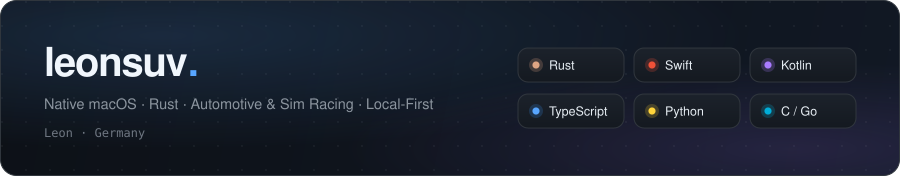

  <picture>
    <source media="(prefers-color-scheme: dark)" srcset="assets/header-dark.svg" />
    <source media="(prefers-color-scheme: light)" srcset="assets/header-light.svg" />
    
  </picture>

 

<table>
  <tr>
    <td width="50%" valign="top">
      
       
      <a href="https://github.com/leonsuv/worldmap"><strong>WORLDMAP</strong></a> · Rust · React · MapLibre 
      Live flights, AIS vessels, weather, power grids &amp; infrastructure on a self-hosted map.
    </td>
    <td width="50%" valign="top">
      
       
      <a href="https://github.com/leonsuv/acxs-manager"><strong>ACXS Manager</strong></a> · Rust 
      All-in-one desktop manager, CSP/ReShade profiles, telemetry &amp; server control for Assetto Corsa.
    </td>
  </tr>
  <tr>
    <td width="50%" valign="top">
      
       
      <a href="https://github.com/leonsuv/MacTuner"><strong>MacTuner</strong></a> · macOS · Swift 
      Native macOS editor for TunerPro XDF definitions — heatmaps, compare, edit &amp; save <code>.bin</code> files.
    </td>
    <td width="50%" valign="top">
      
       
      <a href="https://github.com/leonsuv/cmdtab"><strong>CmdTab</strong></a> · SwiftUI · ScreenCaptureKit 
      Fast native macOS window switcher with live thumbnails, fuzzy search, snapping &amp; pinning.
    </td>
  </tr>
  <tr>
    <td width="50%" valign="top">
      <a href="https://github.com/leonsuv/FastTree">
        <picture>
          <source media="(prefers-color-scheme: dark)" srcset="https://raw.githubusercontent.com/leonsuv/FastTree/main/screenshots/fasttree-dark.png" />
          <source media="(prefers-color-scheme: light)" srcset="https://raw.githubusercontent.com/leonsuv/FastTree/main/screenshots/fasttree-light.png" />
          
        </picture>
      </a>
       
      <a href="https://github.com/leonsuv/FastTree"><strong>FastTree</strong></a> · macOS · Swift 
      Fast native APFS disk space analyzer for macOS with an interactive treemap.
    </td>
    <td width="50%" valign="top">
      <a href="https://github.com/leonsuv/lokalwerk-web">
        <picture>
          <source media="(prefers-color-scheme: dark)" srcset="https://raw.githubusercontent.com/leonsuv/lokalwerk-web/main/docs/screenshots/startseite-register-dunkel.png" />
          <source media="(prefers-color-scheme: light)" srcset="https://raw.githubusercontent.com/leonsuv/lokalwerk-web/main/docs/screenshots/startseite-register-hell.png" />
          
        </picture>
      </a>
       
      <a href="https://github.com/leonsuv/lokalwerk-web"><strong>Lokalwerk</strong></a> · TypeScript 
      33 browser-only tools for PDFs, photos, spreadsheets &amp; SEPA — files never leave the device.
    </td>
  </tr>
</table>

  
    Also:
    <a href="https://github.com/leonsuv/elmdash">elmdash</a> (Opel Corsa-e Android Auto OBD2) ·
    <a href="https://github.com/leonsuv/hwgt6">hwgt6</a> (Opel Connect on Huawei Watch GT6) ·
    <a href="https://github.com/leonsuv/SiliconPulse">SiliconPulse</a> (Apple Silicon menu bar) ·
    <a href="https://github.com/leonsuv/SMBTVPlayer">SMBTVPlayer</a> (Android TV SMB player) ·
    <a href="https://github.com/leonsuv/CCastControl">CCastControl</a> ·
    <a href="https://github.com/leonsuv/fritzbox-6660-cable-debrand">FRITZ!Box 6660 Debrand</a> ·
    <a href="https://github.com/leonsuv/ax88179-macos-driver-guide">AX88179 macOS Guide</a>
  

